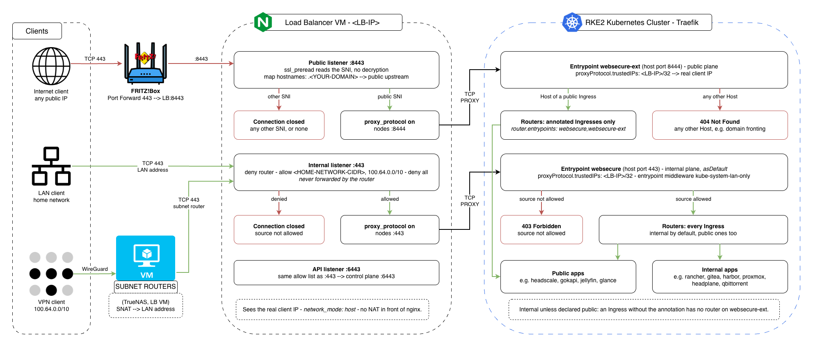

# Internal and Public Ingress Planes

Below is how ingress traffic is split into two planes in this homelab: an **internal plane**, reachable only from the LAN and the VPN, and a **public plane**, reachable from the internet, where only applications explicitly declared public are served.

Every application is internal by default. Publishing one requires two explicit steps, and forgetting either keeps it internal: a configuration mistake can make an application unreachable, never accidentally public.


## 1. Why

Before this change, internal applications (`*.homelab`) were considered private because no public DNS resolves their names. **DNS is not access control**:

- Anyone connecting to the public IP can ask for any name, e.g. `curl --resolve rancher.homelab:443:<PUBLIC-IP> https://rancher.homelab/`. The router forwarded it, and Traefik routed it by name.
- Filtering by SNI on the load balancer is not enough on its own. A client can send a public name in the SNI and an internal one in the encrypted `Host` header (domain fronting), and Traefik routes by `Host`.
- Filtering by source IP inside the cluster was not possible: Traefik saw every connection coming from the load balancer.

The fix separates the two kinds of traffic at the network level, before any name is read, and adds independent checks on top.


## 2. Design



| Plane | Load balancer listener | Traefik entrypoint | Reachable from | Serves |
|---|---|---|---|---|
| Internal | `443` | `websecure` (host port `443`), `asDefault` | LAN, VPN | every Ingress |
| Public | `8443` | `websecure-ext` (host port `8444`) | internet (router forward) | only Ingresses annotated as public |
| Kubernetes API | `6443` | - (control plane `6443`) | LAN, VPN | API server |

The router forwards external `443` to the load balancer's **public** listener (`8443`) and nothing else. The internal listener is never forwarded, so internet traffic cannot reach the internal plane no matter which name it asks for.

**Protection layers:**

| Plane | Layer | Check |
|---|---|---|
| Internal | Router | No port forward to `443` |
| Internal | NGINX | `allow` LAN and VPN ranges, `deny` the router address, `deny all` |
| Internal | Traefik | `lan-only` Middleware on the whole `websecure` entrypoint, using the real client IP |
| Public | NGINX | SNI must be `<YOUR-DOMAIN>` or a subdomain, otherwise the connection is closed |
| Public | Traefik | Only annotated Ingresses have a router on `websecure-ext`, any other `Host` returns `404` |

**Real client IP.** Both ingress listeners send a [PROXY protocol](https://www.haproxy.org/download/2.9/doc/proxy-protocol.txt) header carrying the client address. Traefik trusts it only from the load balancer (`proxyProtocol.trustedIPs`). From any other source the header is ignored, so it cannot be spoofed by connecting to a node directly. NGINX runs with `network_mode: host`, so the address it forwards is the real one and not a Docker NAT address.

Configuration files:

| File | Purpose |
|---|---|
| [middleware-lan-only.yaml](../../../infra/k8s/core/traefik/middleware-lan-only.yaml) | Source allowlist for the internal plane |
| [rke2-traefik-config.yaml](../../../infra/k8s/core/traefik/rke2-traefik-config.yaml) | Traefik entrypoints, PROXY protocol, default entrypoint |
| [nginx.conf](../../../infra/load-balancer/nginx/conf/nginx.conf) | Load balancer listeners |
| [docker-compose.yaml](../../../infra/load-balancer/nginx/docker-compose.yaml) | NGINX on the host network |

> Note: replace every `<...>` placeholder with values from your environment: `<HOME-NETWORK-CIDR>` (home network), `<LB-IP>` (load balancer VM), `<ROUTER-IP>`, `<PIHOLE-IP>`, `<PUBLIC-IP>` (the router's public address), `<YOUR-DOMAIN>` (public domain), `<MAGIC-DNS-DOMAIN>` (Headscale MagicDNS base domain), `<node-ip>` (any cluster node). `100.64.0.0/10` is the Headscale default tailnet range. The internal zone is `homelab` in the examples - use your own.

> Note: keep real values out of the repository. The commands below render each file with `sed` into a working copy, or into a pipe, instead of editing the files under `infra/` in place.


## 3. Prerequisites

| Requirement | Details |
|---|---|
| Traefik as ingress controller | See [rke2-bootstrap.md](../../rke2-bootstrap.md) ("Choose the Ingress Controller") |
| Load balancer VM | See [load-balancer.md](../../load-balancer.md) |
| Pi-hole as internal DNS | Resolves the internal zone to the load balancer - see [load-balancer.md](../../load-balancer.md) |
| Headscale VPN with subnet routers | See [headscale.md](../apps/headscale.md) |
| cert-manager ClusterIssuer for internal names | Issues the certificates of the internal zone, which Let's Encrypt cannot validate - see [cert-manager-internal.md](cert-manager-internal.md) |
| Router admin access | To change the port forward (FRITZ!Box in this setup) |
| A client outside the network | A laptop tethered to a phone on mobile data, with the home Wi-Fi and the VPN off, for the internet tests |
| Cluster admin kubeconfig | See [update-kubeconfig.sh](../../../infra/k8s/bootstrap/update-kubeconfig.sh) |
| `curl`, `dig` | On the laptop used for the tests |


## 4. Publishing an Application

### Internal application (default)

A standard Ingress with `ingressClassName: traefik` and **no** entrypoint annotation. Nothing else is needed on the cluster side - this also covers Ingresses created by Helm charts (Rancher, Gitea, Harbor).

Give it a name in the internal zone (`*.homelab` in this setup) and a Pi-hole DNS record pointing that name to the load balancer. LAN clients use Pi-hole directly, VPN clients through split DNS (see 5.5).

> Note: do not use a name under the public domain for an internal application. Public DNS resolves it to the public IP (always, with a wildcard record as in this setup), so clients land on the public plane, where an internal Ingress has no router and returns `404`.

### Public application

Both are required:

1. The Ingress carries:

   ```yaml
   metadata:
     annotations:
       traefik.ingress.kubernetes.io/router.entrypoints: websecure,websecure-ext
   ```

2. Its hostname is under `<YOUR-DOMAIN>`, with a public DNS record on Cloudflare.

Always list **both** entrypoints. The annotation only chooses where Traefik serves the Ingress; it does not change which Middlewares apply. Middlewares are bound to the entrypoint, not to the Ingress:

| Entrypoint | Reached through | `lan-only` |
|---|---|---|
| `websecure-ext` | The router and the load balancer's public listener | Not applied - the public plane accepts any source |
| `websecure` | The load balancer's internal listener | Applied, as for every internal application |

> Note: a public hostname resolves to the public IP from the LAN too, unless Pi-hole has a local record for it. Without one, LAN clients reach public applications through the router (hairpin NAT), on `websecure-ext`, like internet clients. `websecure` serves them when a client reaches the load balancer's internal listener directly - e.g. with a Pi-hole record pointing the public name to `<LB-IP>`. Listing it costs nothing and keeps LAN access independent of hairpin NAT support on the router.

> Note: exposure is per Ingress, not per path. To keep part of a public application internal (e.g. an admin UI under `/admin`), move that path to a second Ingress on a name in the internal zone, without the annotation. A second Ingress on the same public hostname would not work: that name resolves to the public IP from the LAN too, so it always lands on the public plane, where the internal path has no router.

For Helm charts that ever need to be public, the annotation goes in the chart values:

| Chart | Values key |
|---|---|
| Rancher | `ingress.extraAnnotations` |
| Gitea | `ingress.annotations` |
| Harbor | `expose.ingress.annotations` |


## 5. Rollout

Each step is verified and can be rolled back on its own. Steps 5.2 to 5.6 change nothing for the protection: it is switched on at steps 5.7 and 5.8, and switched off by reverting the router and NGINX only.

Keep the order: split DNS (5.5) must be in place before the new NGINX configuration (5.6), because from 5.6 on the Kubernetes API listener rejects traffic that reaches the load balancer through its own Tailscale address.

### 5.1 Baseline and backups

Record the current response codes of every public and internal hostname, from the external client and from the LAN. They are the reference for every later check:

```bash
PUB=<PUBLIC-IP>
HOSTS=(<YOUR-DOMAIN> vpn.<YOUR-DOMAIN> rancher.homelab gitea.homelab proxmox.homelab)

# External client (mobile data, VPN off)
for h in "${HOSTS[@]}"; do
  printf '%-30s %s\n' "$h" "$(curl -sk -o /dev/null -m 10 -w '%{http_code}' --resolve "$h:443:$PUB" "https://$h/")"
done | tee baseline-internet.txt

# LAN
for h in "${HOSTS[@]}"; do
  printf '%-30s %s\n' "$h" "$(curl -sk -o /dev/null -m 10 -w '%{http_code}' "https://$h/")"
done | tee baseline-lan.txt
```

Before this change, internal hostnames answer from the internet exactly as from the LAN: that is the vulnerability.

On the router, check the port forwards: only `443` towards the load balancer is expected - no `80`, no `6443`, and no IPv6 port sharing for the load balancer or the cluster nodes.

Back up the files and resources that will change:

```bash
# Cluster
kubectl get ingress -A -o yaml > backup-ingresses.yaml

# Control plane
sudo cp /var/lib/rancher/rke2/server/manifests/rke2-traefik-config.yaml ~/rke2-traefik-config.yaml.bak

# Load balancer VM, from the directory holding nginx/
cp nginx/conf/nginx.conf nginx/conf/nginx.conf.bak
cp nginx/docker-compose.yaml nginx/docker-compose.yaml.bak
```

### 5.2 Create the lan-only Middleware

Render [middleware-lan-only.yaml](../../../infra/k8s/core/traefik/middleware-lan-only.yaml) with your home network and apply it:

```bash
HOME_CIDR=<HOME-NETWORK-CIDR>     # e.g. 192.168.1.0/24
sed "s#<HOME-NETWORK-CIDR>#$HOME_CIDR#" infra/k8s/core/traefik/middleware-lan-only.yaml | kubectl apply -f -
kubectl -n kube-system get middleware.traefik.io lan-only
```

**Effect:** none, nothing references it yet.

**Rollback:** `kubectl -n kube-system delete middleware.traefik.io lan-only` (only after 5.3 has been rolled back).

### 5.3 Apply the Traefik configuration

Render [rke2-traefik-config.yaml](../../../infra/k8s/core/traefik/rke2-traefik-config.yaml) with the load balancer address and install it on the control plane as `/var/lib/rancher/rke2/server/manifests/rke2-traefik-config.yaml`:

```bash
LB_IP=<LB-IP>
sed "s#<LB-IP>#$LB_IP#g" infra/k8s/core/traefik/rke2-traefik-config.yaml > rke2-traefik-config.yaml
scp -i <SSH-KEY> rke2-traefik-config.yaml <USER>@<CONTROL-PLANE-IP>:/tmp/
ssh -t -i <SSH-KEY> <USER>@<CONTROL-PLANE-IP> \
  'sudo install -m 0600 -o root -g root /tmp/rke2-traefik-config.yaml /var/lib/rancher/rke2/server/manifests/ && rm /tmp/rke2-traefik-config.yaml'
```

RKE2 applies changes in that directory automatically, then the DaemonSet rolls one node at a time:

```bash
kubectl -n kube-system rollout status daemonset/rke2-traefik
kubectl -n kube-system get daemonset rke2-traefik \
  -o jsonpath='{.spec.template.spec.containers[0].args}' | tr ',' '\n' |
  grep -E 'asDefault|middlewares|proxyProtocol|websecure-ext'
for p in $(kubectl -n kube-system get pods -l app.kubernetes.io/name=rke2-traefik -o name); do
  echo "$p started $(kubectl -n kube-system get "$p" -o jsonpath='{.status.startTime}')"
  kubectl -n kube-system logs "$p" | sed 's/\x1b\[[0-9;]*m//g' | grep ' ERR ' | awk '{print $1}' | sort | uniq -c
done
```

Expect the new arguments, and errors - if any - only within the first seconds after each pod started.

> Note: right after a Traefik pod starts, its log may show a burst of `middleware "kube-system-lan-only@kubernetescrd" does not exist` (and similar errors for other CRD resources, such as a `ServersTransport`) for every router on `websecure`. The Ingress provider delivers its routers before the CRD provider has loaded the Middleware; the configuration converges on its own a second later. Errors that keep appearing after startup mean the Middleware is really missing: check 5.2.

**Effect:** none for clients. Traefik still sees the load balancer as the source of every connection, and that address is inside the allowed range. Nothing sends traffic to `websecure-ext` yet.

**Verify** that every host answers as in the baseline from the LAN, then that the entrypoint middleware is enforced. A pod IP is outside the allowed ranges, so a request sent straight to a Traefik pod must be rejected:

```bash
POD_IP=$(kubectl -n kube-system get pod -l app.kubernetes.io/name=rke2-traefik -o jsonpath='{.items[0].status.podIP}')
kubectl run lan-only-check --rm -i --restart=Never --image=curlimages/curl:8.11.1 -- \
  curl -sk -o /dev/null -w '%{http_code}\n' -H 'Host: rancher.homelab' "https://$POD_IP:8443/"
```

Expected output: `403`.

**Rollback:** restore `~/rke2-traefik-config.yaml.bak` to the manifests directory.

### 5.4 Fix and mark the Ingresses

List every Ingress and decide, for each one, whether it is public:

```bash
kubectl get ingress -A
```

**Fix the Ingresses that do not fit one exposure level** (see section 4) before annotating:

- an application that becomes internal: move it to a name in the internal zone, with a certificate from the internal issuer (see [cert-manager-internal.md](cert-manager-internal.md));
- an Ingress that mixes public and internal paths on the same host: split it into two Ingresses, the internal part on a name in the internal zone. In this setup Headscale stays public on `vpn.<YOUR-DOMAIN>`, while its admin UI Headplane moves to an internal name - see [headscale.md](../apps/headscale.md).

For each new internal name, **create the Pi-hole record first** (`<NAME>.homelab` → `<LB-IP>`), then apply the Ingress. The record only lives in Pi-hole and does not depend on the cluster, so it can be checked on its own:

```bash
dig +short @<PIHOLE-IP> <NAME>.homelab     # <LB-IP>
kubectl apply -f <INGRESS-MANIFEST>
kubectl -n <NAMESPACE> get certificate     # READY True
curl -sk -o /dev/null -w '%{http_code}\n' https://<NAME>.homelab/
```

The old public name of an application moved to the internal zone now returns `404`, from a catch-all Ingress if there is one, otherwise from Traefik itself.

> Note: when Headplane moves to an internal name, update `server.base_url` in the `headplane-config` ConfigMap and restart the Headscale pod, which runs both containers. Its Ingress then serves `/admin` only on the internal name. On the public hostname, `/admin` falls through to Headscale, which answers any unknown path with the same empty page as `/` (`200`): to check that Headplane is no longer reachable there, look at the content, not at the status code - `curl -sk https://vpn.<YOUR-DOMAIN>/admin | grep -ci headplane` must print `0`.

**Annotate each public Ingress:**

```bash
kubectl -n <NAMESPACE> annotate ingress <NAME> \
  traefik.ingress.kubernetes.io/router.entrypoints=websecure,websecure-ext
kubectl get ingress -A -o custom-columns='NS:.metadata.namespace,NAME:.metadata.name,HOSTS:.spec.rules[*].host,EP:.metadata.annotations.traefik\.ingress\.kubernetes\.io/router\.entrypoints'
```

Only the public Ingresses must show `websecure,websecure-ext`. Keep the manifests in sync: the public Ingresses under `infra/k8s/apps/` already carry the annotation.

**Effect:** none for the protection, nothing reaches `websecure-ext` yet. Applications moved to an internal name change address.

**Rollback:** `kubectl apply -f backup-ingresses.yaml` restores every Ingress as recorded in 5.1. For a single annotation: `kubectl -n <NAMESPACE> annotate ingress <NAME> traefik.ingress.kubernetes.io/router.entrypoints-`

### 5.5 Resolve internal names through Pi-hole on the VPN

VPN clients must resolve internal names to the load balancer's **LAN** address, the same answer LAN clients get from Pi-hole. Configure split DNS in Headscale, so that queries for the internal zone go to Pi-hole and everything else keeps using the global resolvers:

```yaml
dns:
  nameservers:
    split:
      homelab:
        - <PIHOLE-IP>
```

**Why:** Tailscale runs in userspace mode on the load balancer, so connections to its own Tailscale address reach nginx from loopback (`127.0.0.1`), which the new listeners reject from 5.6 (Kubernetes API) and 5.8 (internal plane) on. With split DNS, VPN clients reach the load balancer through a subnet router like any other LAN destination, with the subnet router's LAN address as source. It also keeps a single source of truth for internal names: Pi-hole.

**1. Add the split nameserver.** In Headplane, open **DNS** and click **Add nameserver**:

| Field | Value |
|---|---|
| Nameserver | `<PIHOLE-IP>` |
| Split DNS (under *Restrict to domain*) | enabled |
| Domain | `homelab` |

Leave the global nameservers unchanged.

**2. Restart Headscale.** Headplane writes the setting to `/etc/headscale/config.yaml` on the Headscale PVC, but without an integration configured it does not restart Headscale, which reads that file only at startup:

```bash
kubectl -n headscale rollout restart deployment/headscale
kubectl -n headscale rollout status deployment/headscale
kubectl -n headscale logs deploy/headscale -c headscale --tail=30 | grep -iE 'error|fatal'
```

Expect no output from the last command. Reload Headplane's DNS page: the split entry must still be listed.

> Note: the same setting can be edited directly in `/etc/headscale/config.yaml` on the Headscale PVC, followed by the same restart. The `headscale-config` ConfigMap is not an option on a running installation: it only seeds that file on first start (see [headscale.md](../apps/headscale.md)).

> Note: Headscale and Headplane share one pod. If Headscale fails to start after the change, the pod is not Ready and Headplane is unreachable through the Ingress. Reach it directly with `kubectl -n headscale port-forward deploy/headscale 3000:3000` and open `http://localhost:3000/admin`.

**3. Move the internal records to Pi-hole.** Every internal name defined in Headplane's **DNS Records** - the Kubernetes API name included - must exist in Pi-hole, pointing to `<LB-IP>`. Take a screenshot of the record list as a backup, create any missing Pi-hole record, then delete the Headscale records. Record changes take effect without a restart.

**Verify** from a VPN client outside the network (mobile data, VPN on):

```bash
tailscale dns status | sed -n '/Split DNS Routes/,/Search Domains/p'   # homelab -> <PIHOLE-IP>
dig +short rancher.homelab                                             # <LB-IP>
dig +short <DEVICE>.<MAGIC-DNS-DOMAIN>                                 # its 100.64.x.x address
curl -sk -o /dev/null -w '%{http_code}\n' https://rancher.homelab/     # as in baseline-lan.txt
kubectl get nodes                                                      # through the Kubernetes API name
```

On macOS, flush the DNS cache first (`sudo dscacheutil -flushcache; sudo killall -HUP mDNSResponder`) and use `dscacheutil -q host -a name <NAME>` instead of `dig`, which bypasses the system resolver.

> Note: if the MagicDNS base domain is inside the internal zone (e.g. `example.homelab`), device names keep resolving through MagicDNS: the client matches the most specific suffix first. The `<DEVICE>.<MAGIC-DNS-DOMAIN>` check above confirms it.

**Effect:** none for the protection. VPN clients take the subnet route instead of the load balancer's Tailscale address.

**Rollback:** remove the split nameserver in Headplane, restart Headscale, and recreate the deleted records from the screenshot.

### 5.6 Add the public listener on the load balancer

Render [nginx.conf](../../../infra/load-balancer/nginx/conf/nginx.conf) with your values (node addresses, `<HOME-NETWORK-CIDR>`, `<ROUTER-IP>`, `<YOUR-DOMAIN>`) into a working copy, then copy it and [docker-compose.yaml](../../../infra/load-balancer/nginx/docker-compose.yaml) to the load balancer VM.

For this step only, comment out these five lines in the internal `server` block (`listen 443`). Until the router is switched in 5.7, internet traffic still arrives on `443`, and the access rules would cut it off:

```nginx
        # deny  <ROUTER-IP>;
        # allow <HOME-NETWORK-CIDR>;
        # allow 100.64.0.0/10;
        # deny  all;
        # proxy_protocol on;
```

Validate, then recreate the container (the network mode changes):

```bash
docker run --rm -v "$PWD/nginx/conf/nginx.conf:/etc/nginx/nginx.conf:ro" nginx:stable nginx -t
docker compose -f nginx/docker-compose.yaml up -d
sudo ss -ltnp | grep -E ':(443|8443|6443|8999) '
```

**Effect:** a few seconds of downtime while the container is recreated, then everything as before.

**Verify the public plane from the LAN**, before any internet traffic is sent to it:

```bash
LB=<LB-IP>
code() { curl -sk -o /dev/null -m 10 -w '%{http_code}\n' "$@"; }

code --connect-to ::$LB:8443 https://vpn.<YOUR-DOMAIN>/                            # same code as baseline
code --connect-to ::$LB:8443 https://rancher.homelab/                              # 000 - connection closed
code --connect-to ::$LB:8443 -H 'Host: rancher.homelab' https://<YOUR-DOMAIN>/     # 404 - no public router
code https://$LB:8443/                                                             # 000 - no SNI
code https://rancher.homelab/                                                      # 200 - internal plane unchanged
curl -sk --connect-to ::$LB:8443 https://vpn.<YOUR-DOMAIN>/admin | grep -ci headplane   # 0 - admin UI not public
kubectl get nodes                                                                  # Kubernetes API still reachable
```

`docker logs nginx-lb` shows one line per connection, with the listener port, the SNI, the source address and the upstream. The source must be the LAN address of the client: a `172.x` address means nginx is not on the host network.

| Log line | Meaning |
|---|---|
| `port=8443 ... upstream="<node-ip>:8444"` | Public SNI, forwarded to the public plane |
| `port=8443 ... upstream="127.0.0.1:8999"` | Rejected: non-public or missing SNI, sent to the internal sink that closes the connection |
| `port=8999 ...` | The sink side of the same rejected connection |
| `[error] ... recv() failed (104: Connection reset by peer) ... upstream: "127.0.0.1:8999"` | Expected for every rejected connection: the sink closes without reading the forwarded bytes. It is not a failure, and it is a convenient signal to count rejections |

`status=200` in the stream log only means the TCP session ended normally, also for rejected connections: the upstream field is what tells them apart.

> Note: with `reuseport`, `ss -ltnp` lists one socket per worker process for each port - two `0.0.0.0:443` lines on a 2-vCPU VM are expected. With host networking, nginx listens on IPv4 only, unlike Docker's published ports, which also bound `[::]`.

**Rollback:** restore the `.bak` files and run `docker compose -f nginx/docker-compose.yaml up -d`.

### 5.7 Switch the router port forward

Change the router's port forward so that external TCP `443` reaches the load balancer on `8443`. On the FRITZ!Box: **Internet → Permit Access → Port Sharing**, edit the load balancer device and then its active HTTPS rule:

| Field | Value |
|---|---|
| Port to device (from / through) | `8443` / `8443` |
| External port (IPv4 only) | `443` |
| Sharing enabled | checked |

Confirm with **OK**, then **Apply**. Field labels vary with the FRITZ!OS version and language; on another router, the equivalent is a port forward from external TCP `443` to `<LB-IP>:8443`. Leave any IPv6 sharing for the device disabled. The warning about opening port `443` to the internet is expected: it is the one public entry point, now pointing to the public listener only.

**Effect:** the vulnerability is closed. From the internet, only the public plane is reachable.

**Verify from the external client:**

```bash
PUB=<PUBLIC-IP>
code() { curl -sk -o /dev/null -m 10 -w '%{http_code}\n' "$@"; }

code --resolve vpn.<YOUR-DOMAIN>:443:$PUB https://vpn.<YOUR-DOMAIN>/                          # same code as baseline
code --resolve rancher.homelab:443:$PUB https://rancher.homelab/                              # 000
code --resolve <YOUR-DOMAIN>:443:$PUB -H 'Host: rancher.homelab' https://<YOUR-DOMAIN>/       # 404
code https://$PUB/                                                                            # 000
curl -sk --resolve vpn.<YOUR-DOMAIN>:443:$PUB https://vpn.<YOUR-DOMAIN>/admin | grep -ci headplane   # 0
```

Then connect the VPN from the external client and check that it comes up. Over the VPN, check the load balancer log:

```bash
docker logs --tail 40 nginx-lb | grep 'port=8443'
```

The internet requests must show the mobile carrier's public address as source, public SNIs forwarded to `<node-ip>:8444`, everything else to `127.0.0.1:8999`. If they show the router address instead, the router is rewriting the source: stop and roll back, because the source-based rules cannot work in that case.

**Rollback:** set **Port to device** back to `443`.

### 5.8 Enable source filtering on the internal listener

Uncomment the five lines commented in 5.6, then validate and reload:

```bash
docker exec nginx-lb nginx -t
docker exec nginx-lb nginx -s reload
```

**Effect:** Traefik sees the real client IP on the internal plane, and the `lan-only` Middleware becomes effective.

**Verify** that the real client IP reaches the cluster, with a temporary internal echo service:

```bash
kubectl create namespace whoami-check
kubectl -n whoami-check create deployment whoami --image=traefik/whoami:v1.10.3
kubectl -n whoami-check expose deployment whoami --port=80
kubectl -n whoami-check create ingress whoami --class=traefik --rule='whoami.check/*=whoami:80'
kubectl -n whoami-check rollout status deployment/whoami

curl -sk --connect-to ::<LB-IP>:443 https://whoami.check/ | grep -iE 'x-real-ip|x-forwarded-for'

kubectl delete namespace whoami-check
```

`X-Real-Ip` must be the address of the machine running `curl`, not the load balancer. Repeat from a VPN client outside the network: expect the LAN address of a subnet router or a `100.64.x.x` address. Then check that internal applications still open from the LAN and from the VPN.

**Rollback:** comment the five lines again and reload.


## 6. Verification Matrix

| From | Request | Expected | Stopped by |
|---|---|---|---|
| Internet | Public host (`<YOUR-DOMAIN>`, `vpn.<YOUR-DOMAIN>`, ...) | As before | - |
| Internet | VPN client connects | Connected | - |
| Internet | `--resolve rancher.homelab:443:<PUBLIC-IP>` | Connection closed | NGINX (SNI) |
| Internet | SNI `<YOUR-DOMAIN>`, `Host: rancher.homelab` | `404` | Traefik (no public router) |
| Internet | `https://<PUBLIC-IP>/` (no SNI) | Connection closed | NGINX (SNI) |
| Internet | Load balancer log, `port=8443` | Real public source address | - |
| Internet | `https://vpn.<YOUR-DOMAIN>/admin` | Headscale empty page, no Headplane | Traefik (Headplane has no public router) |
| LAN | Internal host | `200` | - |
| LAN, VPN | `X-Real-Ip` seen by the cluster (5.8) | Client LAN address / subnet router address | - |
| LAN | Public host | As before | - |
| VPN (outside) | Internal host | `200` | - |
| VPN (outside) | `kubectl get nodes` | Nodes listed | - |
| Cluster | `kubectl get certificate -A` | All `READY True` | - |


## 7. Emergency Rollback

| Order | What | How |
|---|---|---|
| 1 | Router | Port to device back to `443` |
| 2 | NGINX | Restore `nginx.conf.bak` and `docker-compose.yaml.bak`, `docker compose up -d` |
| 3 | Traefik (only if needed) | Restore `rke2-traefik-config.yaml.bak` |

Steps 1 and 2 alone bring traffic back to the previous behaviour. Without a PROXY header, Traefik sees the load balancer as the source again and the `lan-only` Middleware lets everything through.


## 8. Notes

**Hairpin NAT.** A LAN client using the public IP goes through the router and lands on the public plane, like any internet client: public hosts work, internal ones do not. Testing from the LAN through the public IP is therefore not an internet test. Use mobile data.

**Router address denied.** The router address is denied on the internal listeners. The router never needs them, and if it ever rewrote the source of forwarded traffic (hairpin NAT, a firmware change), that traffic must not pass as LAN.

**IPv6.** In this setup the public DNS records are IPv4 only and the cluster nodes have no IPv6 addresses. Keep IPv6 port sharing disabled on the router for the load balancer and the nodes, otherwise traffic could bypass the load balancer.

**VPN clients.** They reach the home network through the Tailscale subnet routers, which SNAT the traffic to their LAN address, so they count as LAN on both checks. Name resolution is separate from routing: VPN clients resolve internal names through Pi-hole via split DNS (5.5). Do not point internal names to a Tailscale address of the load balancer: that traffic reaches nginx from loopback and is rejected by the internal listener.

**Direct node access.** Clients on the LAN can still connect to a node's `443` (internal plane) or `8444` (public plane). This skips the NGINX checks, not Traefik's: `lan-only` still applies on `443` with the real source address, only public routers exist on `8444`, and a PROXY header sent directly to a node is ignored.


**Certificates.** cert-manager uses DNS-01 challenges, which need no inbound traffic. Issuance and renewal are not affected.
